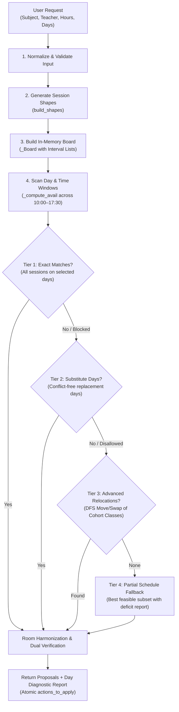

# Weekly Smart Scheduling: Architecture, Algorithm & Implementation

## 1. Overview & Purpose

The **Weekly Smart Schedule** feature is an advanced multi-day routine generator designed for academic timetables. While single-slot smart scheduling finds an isolated 1-hour or 2-hour window for a single class, **Weekly Scheduling** solves the full weekly curriculum requirement for a subject:

- **Weekly Hours Requirement**: Allocates total required teaching hours per week (e.g., $6.0\text{h}$, $4.5\text{h}$, $3.0\text{h}$) for a given subject, teacher, and class group (Program + Semester).
- **Day Preference & Distribution**: Distributes sessions across user-preferred days based on flexible day rules (`exactly`, `at_least`, `at_most` $k$ days).
- **Strict Academic Hard Constraints**: Enforces zero student clashes, zero teacher clashes, room availability, max 1 theory/practical per teacher per day, teacher free-day rules, and teacher unavailabilities.
- **Smart Re-arrangement & Atomic Application**: If preferred days are congested, it can either propose zero-conflict substitution days or perform a bounded search to relocate non-conflicting existing classes of the same cohort to unlock the requested slots.

---

## 2. Source Code Locations

The feature is implemented across both the backend engine and the frontend UI:

| Layer | File Path | Key Responsibilities |
| :--- | :--- | :--- |
| **Backend Core Algorithm** | [`backend/app/api/schedule_smart_weekly.py`](file:///home/ankit/Downloads/timetable-application/backend/app/api/schedule_smart_weekly.py) | Full scheduling engine: session shape partitioning, in-memory interval board, window evaluation, exact/substitute/advanced search, independent reference verification, and in-memory LRU caching. |
| **Backend API Route Mounting** | [`backend/app/api/router.py`](file:///home/ankit/Downloads/timetable-application/backend/app/api/router.py) | Mounts endpoint at `POST /api/actions/smart-schedule/weekly`. |
| **Academic Rules & Constraints** | [`backend/app/scheduler/constraints.py`](file:///home/ankit/Downloads/timetable-application/backend/app/scheduler/constraints.py)<br>[`backend/app/scheduler/validator.py`](file:///home/ankit/Downloads/timetable-application/backend/app/scheduler/validator.py) | Hard rules (`H1`–`H12`), room capabilities (Theory vs Lab), and teacher sets. |
| **Atomic Action Execution** | [`backend/app/actions/engine.py`](file:///home/ankit/Downloads/timetable-application/backend/app/actions/engine.py) | Executes the atomic sequence (`MOVE_CLASS`, `REMOVE_CLASS`, `ADD_CLASS`) generated by proposals. |
| **Frontend Tab Component** | [`frontend/src/components/actions/WeeklyScheduleTab.tsx`](file:///home/ankit/Downloads/timetable-application/frontend/src/components/actions/WeeklyScheduleTab.tsx) | Interactive UI: day buttons, weekly hours pills, live day-availability diagnostics, proposal comparison carousel/list, and execution handler. |
| **Frontend Modal Host** | [`frontend/src/components/actions/SmartScheduleModal.tsx`](file:///home/ankit/Downloads/timetable-application/frontend/src/components/actions/SmartScheduleModal.tsx) | Modal container hosting the "Weekly Schedule" and "Single Slot" tabs. |
| **Frontend API Client & Types** | [`frontend/src/api.ts`](file:///home/ankit/Downloads/timetable-application/frontend/src/api.ts) | TypeScript interfaces (`WeeklyScheduleRequest`, `WeeklyScheduleResponse`, `WeeklyProposalItem`) and API caller. |
| **Test Suite** | [`backend/tests/test_schedule_smart_weekly.py`](file:///home/ankit/Downloads/timetable-application/backend/tests/test_schedule_smart_weekly.py) | Unit and integration test coverage for validation, exact matching, substitutions, and conflict rejection. |

---

## 3. Input Specification & Selection Modes

### Input Payload (`WeeklyScheduleRequest`)
```json
{
  "program": "B.Tech",
  "semester": "3rd",
  "subject_code": "ds",
  "subject_name": "Data Structure",
  "teacher": "SKS",
  "entry_type": "Theory",
  "room": "R#205",
  "weekly_hours": 6.0,
  "selected_days": ["Tuesday", "Wednesday", "Thursday"],
  "day_rule": "exactly",
  "day_count": 3,
  "outside_days": "auto",
  "include_advanced": true,
  "allow_cancel": false,
  "max_proposals": 6
}
```

### Day Selection Interpretation
1. **Fixed Mode** ($\text{count}(\text{selected\_days}) \le k$ and `day_rule != "at_most"`):
   - Example: The user clicked **Tue, Wed, Thu** with `day_rule="exactly"`, `day_count=3`.
   - The algorithm treats these days as **explicit targets**. If Wednesday is blocked by another class, the algorithm attempts to preserve Tuesday and Thursday, while picking the closest conflict-free replacement day (e.g. Friday) to replace Wednesday.
2. **Pool Mode** ($\text{count}(\text{selected\_days}) > k$):
   - Example: The user clicked **Mon, Tue, Wed, Thu, Fri**, but wants `day_rule="exactly"`, `day_count=3`.
   - The selected days form a **candidate pool**. The algorithm picks the best 3-day subset from within this pool without touching unselected days.
3. **`outside_days` Override**:
   - `"allow"`: Permits days outside the user selection to be considered if selected days fail.
   - `"deny"`: Strictly restricts search to the selected days.
   - `"auto"`: Enabled in Fixed Mode to allow finding replacement days.

---

## 4. The End-to-End Scheduling Algorithm

The algorithm is implemented in [`backend/app/api/schedule_smart_weekly.py`](file:///home/ankit/Downloads/timetable-application/backend/app/api/schedule_smart_weekly.py) within the `_Solver` class and pure function `solve_weekly()`.

### High-Level Architecture Flowchart



---

### Step-by-Step Breakdown

### Step 1: Session Shape Generation (`build_shapes`)
Before assigning time slots, the engine determines **how total weekly minutes $W$ can legally be partitioned into $n$ daily sessions**:
- For **Practical**: Sessions are fixed at $180\text{ min}$ ($3.0\text{h}$) each, and prohibited on Saturdays. Thus, $W$ must be a multiple of $180$.
- For **Theory**: Each daily session must satisfy:
  $$\text{THEORY\_MIN } (60\text{ min}) \le \text{duration} \le \text{THEORY\_MAX } (180\text{ min})$$
  and must align to $30\text{ min}$ increments (`STEP = 30`).

The function `_near_even_shape(W, n, dmin, dmax)` divides $W$ into $n$ parts as evenly as possible.
For example, for **$6\text{ hours}$ ($360\text{ min}$)**:
- $n = 2$ days: $(180, 180)$ $\rightarrow$ $3\text{h} + 3\text{h}$
- $n = 3$ days: $(120, 120, 120)$ $\rightarrow$ $2\text{h} + 2\text{h} + 2\text{h}$ *(ideal shape)*
- $n = 4$ days: $(90, 90, 90, 90)$ $\rightarrow$ $1.5\text{h} \times 4$

Each shape is assigned a shape cost (`_shape_cost`) that penalizes deviations from the pedagogical baseline ($120\text{ min}$) and variance between session durations.

---

### Step 2: High-Speed In-Memory Board (`_Board`)
To evaluate thousands of candidate combinations under a strict deadline ($2.5\text{s}$) without database overhead or expensive full-schedule re-validations, `_Board` maintains indexed interval maps:

1. **Per-Resource Interval Buckets (`by_res`)**:
   - `(0, (program, semester), day)` $\rightarrow$ List of busy intervals for student cohort.
   - `(1, teacher_id, day)` $\rightarrow$ List of busy intervals for the teacher.
   - `(2, room_id, day)` $\rightarrow$ List of busy intervals for each room.
2. **Teacher Daily Allocations (`tt`)**:
   - Tracks counts of `(teacher, day, "Theory")` and `(teacher, day, "Practical")`.
   - Instantly checks rule **H5** (max 1 theory class per teacher per day) and **H5b** (max 1 practical class per teacher per day).
3. **Internal Teacher Working Days (`tdays`)**:
   - Tracks days taught by permanent teachers to enforce rule **H6** (every internal teacher must have at least 1 full working day off out of the 6 working days).
4. **$O(1)$ Attach / Detach**:
   - Adding or removing a hypothetical class takes microseconds, enabling instantaneous state exploration.

---

### Step 3: Day & Window Evaluation (`_compute_avail`)
For each working day (Monday through Saturday):
1. **Day-Level Pruning (`_day_block`)**:
   - **Teacher Busy Slot (`H12`)**: If the teacher has a registered unavailability on this day, the whole day is marked unavailable with reason `"busy"`.
   - **Same Subject Day Rule**: Skips days where the same subject is already scheduled for that semester to promote spaced learning across the week.
   - **Teacher Load (`H5`/`H5b`)**: Checked against existing assignments.
   - **Teacher Free Day (`H6`)**: Checked against the 6-day work week limit.
2. **Time Window Scanning**:
   - Slides a window of duration $D$ from $10:00$ ($600\text{ min}$) to $17:30$ ($1050\text{ min}$) in $30\text{ min}$ steps.
   - Validates student clash (**H1**), teacher clash (**H2**), and room availability (**H3**).
3. **Window Soft Scoring (`_win_cost`)**:
   - Favors standard institutional start times ($10:00$, $12:00$, $14:30$, $16:30$). Non-grid starts incur $+90$ penalty.
   - Lunch break penalty: Crossing $14:00$–$14:30$ incurs $+400$ penalty.
   - Preferred room match: Using a room other than the user's requested room incurs $+30$ penalty.

---

### Step 4: The 4-Tier Suggestion Ladder

Proposals are constructed and sorted strictly following the **Suggestion Ladder**:

```
Tier 1: Exact Match      (Zero disruption, exact selected days)
       ↓ (if blocked)
Tier 2: Substitute Days  (Zero disruption, minimal replacement days)
       ↓ (if blocked / disabled)
Tier 3: Advanced DFS     (Relocates same-cohort blocking classes)
       ↓ (if insufficient)
Tier 4: Partial Fallback (Best feasible partial schedule + shortfall report)
```

#### Tier 1: Exact Match (`exact`)
- The algorithm enumerates combinations of user-selected days (`itertools.combinations`).
- Verifies that cross-day rule **H6** holds for the multi-day bundle.
- Generates proposals that require **no changes to any existing timetable entry**.

#### Tier 2: Conflict-Free Substitution (`substitute`)
- When one or more selected days cannot accommodate a session, the engine expands the candidate pool to include unselected working days.
- It finds the combination that minimizes the number of substitute days (`outside` metric) and retains as many requested days as possible.

#### Tier 3: Advanced Suggestions (`advanced`)
- If zero-disruption options are blocked or unsatisfactory, the solver engages a **Bounded Depth-First Search with Beam Pruning** (`_dfs`, depth limit $= 2$, branch limit $= 8, 3$):
  1. Identifies classes of the **same program and semester** causing the clash on the requested day.
  2. Detaches the blocking class.
  3. Finds the lowest-cost conflict-free alternative slot (`_best_move`) anywhere in the week for that displaced class.
  4. Places the new subject into the freshly unlocked slot.
  5. Backtracks cleanly if no valid relocation exists.
- Produces atomic actions containing `MOVE_CLASS` (or `REMOVE_CLASS` if cancellation is permitted) followed by `ADD_CLASS`.

#### Tier 4: Partial Fallback (`partial`)
- If the full weekly hours cannot be placed under any rule, the engine does not fail silently or generate illegal clashes.
- It calculates the maximum possible hours/days that can legally fit (e.g., $4.0\text{h}$ over 2 days instead of $6.0\text{h}$ over 3 days) and explicitly reports the shortfall:
  ```json
  "shortfall": { "days": 1, "minutes": 120 }
  ```

---

### Step 5: Room Harmonization (`_harmonize`)
To prevent students and instructors from changing classrooms between sessions of the same course:
- The solver examines whether any suitable room (lab or regular classroom) is simultaneously vacant during **all** scheduled sessions across the entire week.
- If found, it harmonizes the room assignment across all sessions.

---

### Step 6: Independent Dual Verification (`_verify`)
To prevent solver bugs or race conditions from ever returning an invalid schedule:
- Every generated proposal is materialized into a complete timetable representation.
- The entire schedule is evaluated by `violation_counter()` (an independent multi-set violation checker) verifying:
  - `H1` (Semester cohort clash)
  - `H2` (Teacher clash)
  - `H3` (Room double-booking)
  - `H5` / `H5b` (Daily teacher class limits)
  - `H6` (Teacher free working day)
  - `H12` (Permanent teacher busy days)
- Any proposal that increases the count of violations compared to the baseline timetable is **silently discarded**.

---

### Step 7: Atomic Execution Payload
The proposal outputs a list of structured actions in `actions_to_apply`:

```json
[
  {
    "action": "MOVE_CLASS",
    "target": {
      "day": "Wednesday",
      "start_time": "10:00",
      "end_time": "12:00",
      "program": "B.Tech",
      "semester": "3rd",
      "subject_code": "co"
    },
    "new_day": "Friday",
    "new_start_time": "14:30",
    "new_end_time": "16:30",
    "new_room": "R#201"
  },
  {
    "action": "ADD_CLASS",
    "spec": {
      "program": "B.Tech",
      "semester": "3rd",
      "day": "Tuesday",
      "start_time": "10:00",
      "end_time": "12:00",
      "subject_code": "ds",
      "subject_name": "Data Structure",
      "teacher": "SKS",
      "entry_type": "Theory",
      "room": "R#205"
    }
  },
  {
    "action": "ADD_CLASS",
    "spec": {
      "program": "B.Tech",
      "semester": "3rd",
      "day": "Wednesday",
      "start_time": "10:00",
      "end_time": "12:00",
      "subject_code": "ds",
      "subject_name": "Data Structure",
      "teacher": "SKS",
      "entry_type": "Theory",
      "room": "R#205"
    }
  },
  {
    "action": "ADD_CLASS",
    "spec": {
      "program": "B.Tech",
      "semester": "3rd",
      "day": "Thursday",
      "start_time": "10:00",
      "end_time": "12:00",
      "subject_code": "ds",
      "subject_name": "Data Structure",
      "teacher": "SKS",
      "entry_type": "Theory",
      "room": "R#205"
    }
  }
]
```

When the user clicks **"Apply Schedule"**, these actions are sent in a single POST request to `/api/actions/execute` with `partial_ok=False`. If any action fails, the entire transaction rolls back, guaranteeing zero partial states.

---

## 5. Concrete Examples & Walkthroughs

### Example 1: Exact Match (Normal Routine Scheduling)
* **Goal**: Schedule **6 hours** of B.Tech 3rd Semester "Data Structure" (Theory) with Teacher "SKS".
* **User Input**:
  - `weekly_hours`: `6.0`
  - `selected_days`: `["Tuesday", "Wednesday", "Thursday"]`
  - `day_rule`: `"exactly"`
  - `day_count`: `3`
* **Algorithm Execution**:
  1. Shapes generated: $(120, 120, 120)$ minutes ($2\text{h}$ each day).
  2. Day check: Tue, Wed, Thu are clear for SKS and B.Tech 3rd Sem.
  3. Best windows found:
     - Tuesday: 10:00–12:00 in Room R#205.
     - Wednesday: 10:00–12:00 in Room R#205.
     - Thursday: 10:00–12:00 in Room R#205.
  4. Room Harmonization: R#205 is free for all three windows.
* **Output**:
  - **Category**: `exact`
  - **Status**: `exact`
  - **Message**: *"Found 3 option(s) for 6h/week, exactly 3 day(s) on Tuesday, Wednesday and Thursday: all sessions are on your selected days and no existing class is changed."*

---

### Example 2: Conflict-Free Substitution (Handling Teacher Busy Days)
* **Goal**: Schedule **4.5 hours** of "Computer Networks" with Teacher "AK".
* **User Input**:
  - `weekly_hours`: `4.5`
  - `selected_days`: `["Monday", "Wednesday", "Friday"]`
  - `day_rule`: `"exactly"`
  - `day_count`: `3`
* **Initial State**: Teacher "AK" has a registered permanent busy day on **Wednesday** (`TeacherBusySlot`).
* **Algorithm Execution**:
  1. Shapes generated: $(90, 90, 90)$ minutes ($1.5\text{h}$ per day).
  2. Availability scan:
     - Monday: Available ($10:00$–$11:30$).
     - Wednesday: **Blocked** (Reason: `"AK is marked unavailable on Wednesday"`).
     - Friday: Available ($10:00$–$11:30$).
  3. Substitution search:
     - Checks unselected working days: Tuesday, Thursday, Saturday.
     - Tuesday has open slots for AK and cohort.
     - Picks Tuesday as the replacement day.
* **Output**:
  - **Category**: `substitute`
  - **Status**: `substituted`
  - **Message**: *"Wednesday can't be scheduled (AK is marked unavailable on Wednesday). Suggested conflict-free replacement day(s): Tuesday; Monday and Friday stay as you selected."*
  - **Sessions**: Mon 10:00–11:30, Tue 10:00–11:30, Fri 10:00–11:30.

---

### Example 3: Advanced Rearrangement (Unlocking a Congested Slot)
* **Goal**: Schedule **4 hours** of "Operating Systems" on **Monday & Tuesday** ($2\text{h}$ each).
* **Initial State**: Monday 10:00–12:00 is occupied by "Computer Organization" (`co`), taught by `DK` for the same B.Tech 3rd Semester cohort. All afternoon slots on Monday clash with labs.
* **Algorithm Execution**:
  1. Tier 1 (Exact) fails because Monday has no free 2-hour window.
  2. Tier 2 (Substitute) is either rejected by user preferences (`outside_days="deny"`) or ranks lower.
  3. Tier 3 (Advanced Search):
     - Solver identifies `co` on Monday 10:00–12:00 as the blocker.
     - Solver detaches `co` and checks where `co` can legally move without disrupting anything else.
     - Solver finds that Thursday 14:30–16:30 is completely open for `DK` and B.Tech 3rd Sem in Room R#201.
     - Solver places the new "Operating Systems" class into Monday 10:00–12:00 in Room R#205.
* **Output**:
  - **Category**: `advanced`
  - **Status**: `needs_changes`
  - **Modifications**:
    - *Move 'Computer Organization' (Mon 10:00–12:00) $\rightarrow$ Thu 14:30–16:30 in R#201 to free Monday.*
  - **Actions**:
    1. `MOVE_CLASS` target `co` to Thu 14:30–16:30.
    2. `ADD_CLASS` "Operating Systems" Mon 10:00–12:00.
    3. `ADD_CLASS` "Operating Systems" Tue 10:00–12:00.

---

## 6. Summary Comparison: Single vs. Weekly Scheduling

| Dimension | Single Smart Schedule | Weekly Smart Schedule |
| :--- | :--- | :--- |
| **Scope** | Single isolated class period (e.g., 1 slot) | Whole weekly curriculum ($W$ hours over $N$ days) |
| **Day Distribution** | Single preferred day | Multi-day allocation (`exactly`, `at_least`, `at_most`) |
| **Session Sizing** | User specifies fixed start & end | Dynamically partitions weekly hours into pedagogically sound shapes |
| **Room Consistency** | Independent room per call | **Room Harmonization** across all weekly sessions |
| **Cross-Day Rules** | Cannot check cross-day constraints | Evaluates **H6** (Internal teacher free day across the full 6-day week) |
| **Diagnostics** | Single error message on failure | Full **`day_report`** diagnosing every single day with specific blocker reasons |
| **Execution** | 1 `ADD_CLASS` action | Atomic bundle of `MOVE_CLASS` + `ADD_CLASS` $\times N$ |
