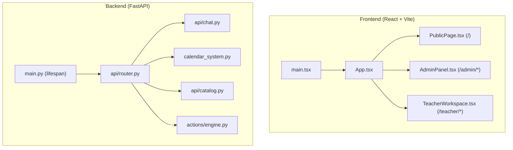
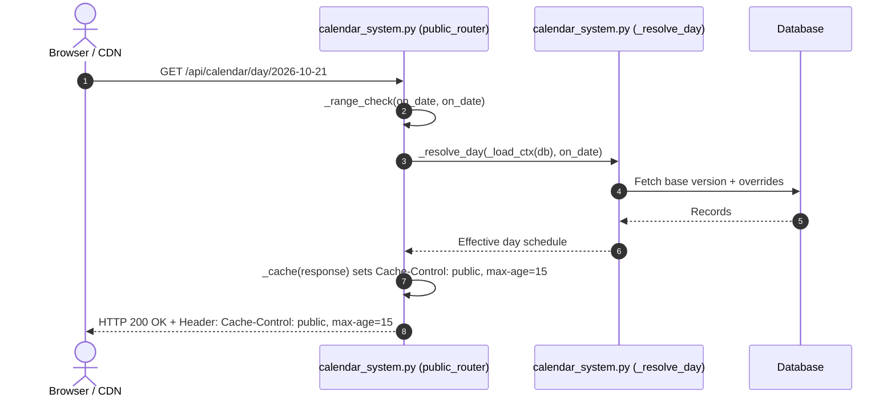
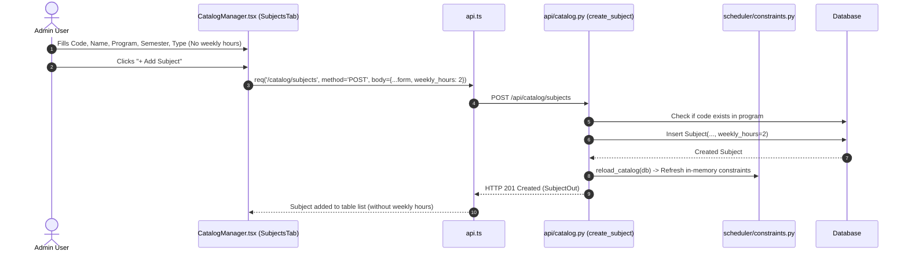
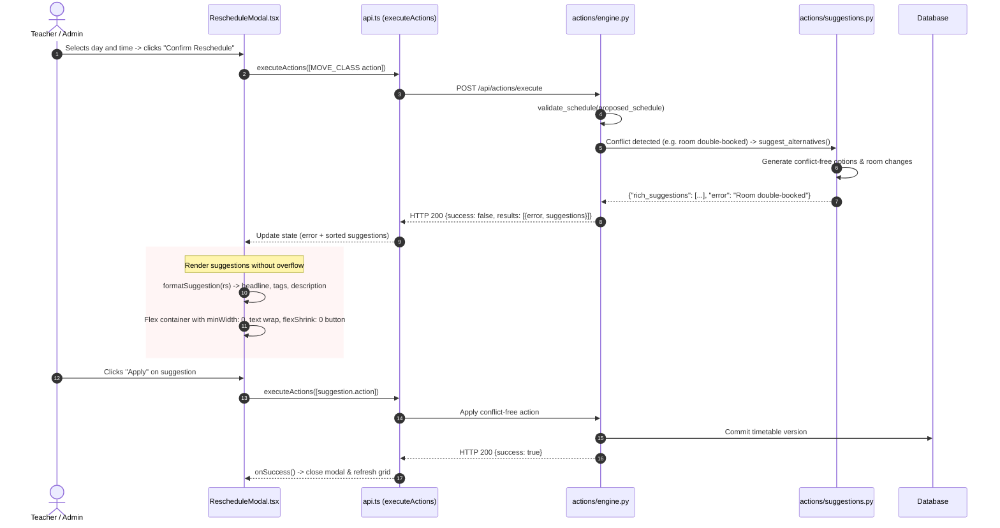

# System Flow & Execution Architecture

This document describes how code flows across files, functions, and components in the timetable application.

---

## 1. Application Entry Points



---

## 2. Order of Execution & Function Call Sequences

### Flow A: Public AI Chat & Date Query Execution

When a student asks a timetable question on the public page (e.g., *"hey AI what classes do i have on this coming wednesay?"*):

```mermaid
sequenceDiagram
    autonumber
    actor User as Student
    participant UI as PublicPage.tsx
    participant API as api.ts (publicChat)
    participant Route as api/chat.py
    participant Svc as chat_service.py
    participant CChat as calendar_chat.py
    participant CalSys as calendar_system.py
    participant DB as SQLite / PostgreSQL

    User->>UI: Types query and clicks Send
    UI->>API: publicChat(text)
    API->>Route: POST /api/public/chat {"message": text}
    Route->>Svc: handle_public_chat(message, db)
    Svc->>CChat: try_handle_calendar_question(message, db)
    CChat->>CChat: answer_calendar_question(db, message, user=None)
    
    rect rgb(240, 245, 255)
        note over CChat: 1. Normalization & Date Scanning
        CChat->>CChat: _norm(message)
        CChat->>CChat: _scan_dates(normalized_text)
        CChat->>CChat: _h_weekday(match) -> kind='weekday', modifier='coming'
        CChat->>CChat: _resolve_spec() -> _upcoming_weekday(today, wd=2, modifier='coming')
    end

    rect rgb(245, 255, 240)
        note over CChat: 2. Intent & Student Scope Check
        CChat->>CChat: _detect_intents() -> ['schedule']
        CChat->>CChat: Check first_person pronoun ("i") + unauthenticated user
        CChat->>CChat: Treat as student: do not reject; add batch filter note
    end

    CChat->>CalSys: _load_ctx(db, target_date, target_date)
    CalSys->>DB: Query CalendarDayOverride & ValidityWindow
    DB-->>CalSys: Active timetable version & overrides
    CalSys->>CalSys: _resolve_day() -> compute effective entries
    CalSys-->>CChat: Effective day schedule
    CChat->>CChat: _section_schedule(views, spans, filters)
    CChat-->>Svc: {"message": formatted_markdown, "response_data": {...}}
    Svc-->>Route: ChatResponse
    Route-->>API: HTTP 200 OK JSON
    API-->>UI: Render message with ReactMarkdown
```

---

### Flow B: HTTP Caching for Public Calendar Endpoints



---

### Flow C: Catalog Subject Management Flow



---

### Flow D: Reschedule Conflict Resolution & Suggestion UI Flow



---

## 3. Control Flow Across Files and Modules

| Layer | Files | Responsibilities |
|---|---|---|
| **Frontend UI** | `CatalogManager.tsx` | Manages subjects, teachers, programs without weekly hours clutter. |
| | `RescheduleModal.tsx` | Slot picker, error banner, structured suggestion pills, overflow-proof cards. |
| | `PublicPage.tsx` | Public timetable viewer, responsive chat drawer, calendar drawer. |
| **API Client** | `frontend/src/api.ts` | Dispatches requests to `/api/catalog/*`, `/api/actions/*`, `/api/public/chat`. |
| **Backend Routing** | `backend/app/api/chat.py` | Handles `/api/public/chat` and `/api/teacher/chat` requests. |
| | `backend/app/calendar_system.py` | Handles `/api/calendar/*` endpoints, applies 15-second `Cache-Control`. |
| | `backend/app/api/catalog.py` | CRUD operations for subjects, teachers, programs. |
| **Core Engines** | `backend/app/calendar_chat.py` | NLP parser, date typo resolution, intent detection, student & teacher filtering. |
| | `backend/app/services/chat_service.py` | High-level dispatcher between calendar chat hook and LLM fallback. |
| | `backend/app/actions/engine.py` | Action validator, conflict detection, transaction rollback. |
| | `backend/app/actions/suggestions.py` | Conflict-free alternative generator and ranker. |
